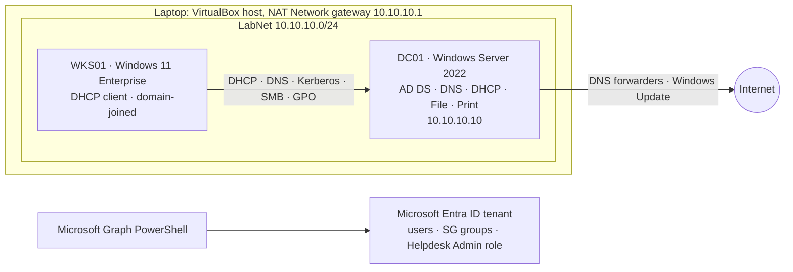

# Windows Server & Azure Admin Lab

A small company network I built on my laptop to practise junior systems administrator work. It covers Active Directory, DNS/DHCP, file and print, Group Policy patch rings, service desk tickets, daily health monitoring and Microsoft Entra ID, with the routine work automated in PowerShell.

Everything here runs on free evaluation software: a Windows Server 2022 domain controller, a Windows 11 Enterprise workstation and an Azure for Students tenant.



## What's in the lab

| Area | What gets built | Where |
|---|---|---|
| Windows Server | DC01: static IP, AD DS, DNS, DHCP, File Server and Print Server roles | `scripts/dc/01`–`03` |
| Active Directory | Forest `jslab.internal`, 5 department OUs, 25 users, 18 security groups (AGDLP), password and lockout policy | `scripts/dc/04`–`05` |
| Least privilege | `GG_IT_Helpdesk` can reset passwords and unlock users, and nothing else (dsacls delegation) | `scripts/dc/04` |
| DNS / DHCP | Forwarders, reverse zone, PTR/A records, scavenging, scope with options 003/006/015, reservation | `scripts/dc/03` |
| File & print | 5 SMB shares with group-based NTFS permissions, access-based enumeration, a shared printer published in AD | `scripts/dc/06`–`07` |
| Patching | 2 Windows Update rings by GPO (pilot: 0-day deferral; broad: 7-day), security-filtered by group, plus a patch compliance report | `scripts/dc/08`, `scripts/ops/Get-PatchCompliance.ps1` |
| Service desk | 15 sample tickets (new users, resets, unlocks, access changes, offboarding) worked by a script that logs every action and escalates privileged requests | `scripts/ops/Invoke-TicketQueue.ps1` |
| Monitoring | 10-check DC health report (services, dcdiag, DNS, DHCP usage, disk, reboot, patch age, locked, stale and never-expiring accounts) on a daily scheduled task | `scripts/ops/Get-LabHealthReport.ps1` |
| Azure / Entra ID | Lab users and groups mirrored to Entra ID with Graph PowerShell, Helpdesk Administrator role, Azure RBAC on a resource group | `scripts/cloud/Sync-EntraLabUsers.ps1` |
| Documentation | 5 runbooks, a step-by-step build guide, 8 break/fix exercises | `docs/` |

## Repository layout

```
scripts/
  host/    00-New-HyperVLab.ps1       switch, NAT and both VMs (run on the laptop)
  dc/      01..08                     domain controller build, run in order on DC01
  client/  Join-LabDomain.ps1         checks DHCP/DNS/SRV, then joins WKS01
  ops/     Invoke-TicketQueue.ps1     service desk queue
           Get-LabHealthReport.ps1    daily health check
           Get-PatchCompliance.ps1    patch status across the domain
  cloud/   Sync-EntraLabUsers.ps1     Entra ID users, groups, admin role
  common/  LabHelpers.ps1             password generator, username rules
data/      users.csv (25 staff), tickets.csv (15 tickets)
docs/      LAB-GUIDE.md, runbooks/RB-01..RB-05
tests/     Test-TicketQueue.ps1       offline test with a fake AD (38 checks)
```

## Build order

Follow **[docs/LAB-GUIDE.md](docs/LAB-GUIDE.md)**. In short:

1. Laptop: VirtualBox NAT Network + 2 VMs (Option B in the guide), or `scripts/host/00-New-HyperVLab.ps1` on Hyper-V
2. DC01: `01-Initialize-Server` → reboot → `02-Install-Forest` → reboot → `03-Set-DnsDhcp`
3. WKS01: install Windows 11, run `client/Join-LabDomain.ps1`
4. DC01: `04-New-ADStructure` → `05-New-LabUsers` → `06-New-FileShares` → `07-New-LabPrinter` → `08-New-PatchGPOs`
5. Operate: tickets, health report, patch compliance, break/fix exercises
6. Cloud: Azure for Students tenant → `cloud/Sync-EntraLabUsers.ps1`

## Testing

The ticket queue has an offline test that swaps the AD cmdlets for an in-memory fake directory, so it runs on any OS with PowerShell 7:

```powershell
pwsh ./tests/Test-TicketQueue.ps1     # 38 passed, 0 failed
```

It checks every ticket outcome, that `-WhatIf` changes nothing, that privileged requests are never actioned, that passwords never reach the ticket log, and that a re-run only retries unresolved tickets.

## Results

Ticket queue run against `data/tickets.csv`:

```
INC-1001  NewUser         Nora Lambert   Resolved   Created nlambert in OU=Finance; added to GG_Finance
INC-1003  NewUser         Elena Garcia   NeedsInfo  Missing Department. Asked opelletier for the details...
INC-1007  UnlockAccount   wnguyen        Resolved   Unlocked wnguyen
INC-1010  AddToGroup      dpark          Escalated  'Domain Admins' is a privileged group. Needs IT Manager approval...
INC-1013  Offboard        lmartin        Resolved   Disabled lmartin; removed 1 group(s); moved to OU=Disabled
...
Summary: 2 Escalated, 3 NeedsInfo, 10 Resolved
```

Screenshots from my build go in `docs/screenshots/`: ADUC OU tree, DHCP scope and leases, `gpresult /r` on WKS01, the health report and the Entra ID groups.

## Notes

- **Lab only.** The `output/` folder holds temporary passwords and is git-ignored. Never reuse lab passwords.
- Evaluation licences: Windows Server 180 days, Windows 11 Enterprise 90 days. Take VirtualBox snapshots before big changes.
- The DC also runs DHCP, file and print to save RAM. In production these roles go on separate servers, and the Print Spooler stays off on domain controllers (PrintNightmare).

MIT licence.
